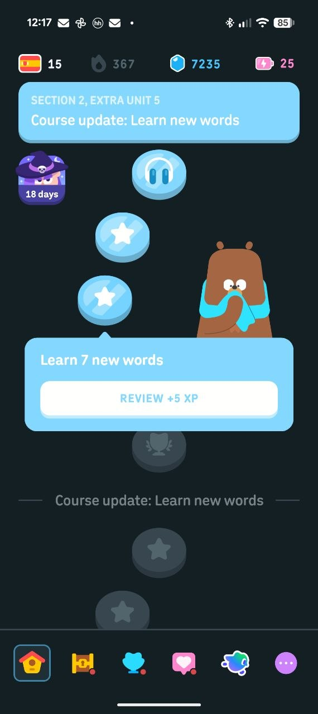

# Визуальная задача: управление уроком, подсказка, озвучка и меню пройденного урока

Назначение: передача другому агенту. Этот документ содержит визуальную часть нового запроса пользователя. Логика реализована отдельно; финальный визуал новых элементов в этой итерации не выполняется.

Проект: `/Users/maxim_kio/Code/reading-school`. Источник: прямой запрос пользователя от 3 ноября 2026 и приложенный референс. Он заменяет прежний запрет ТЗ на помощь и звук. Не возвращать на итог урока кнопку оформления профиля.

## Визуальная основа

Сохранить текущую тему, шрифты и действующие токены. Pofo — интерфейс; Ahner — только учебные слова. Интерактивные области минимум 56×56 px. Избегать новых переопределений общих `.icon` и `.reading-unit`. Длительности и кривые должны оставаться в едином перечне переменных.

`src/functional.css` сейчас задаёт только минимальную компоновку, ограничение высоты и прокрутку новых модальных окон. Эти правила — временная функциональная оболочка, а не финальное художественное решение. При финальной интеграции объединить их с системой компонентов; не накладывать новую цепочку `!important` и селекторов повышенной специфичности.

## 1. Панель задания

- Слева — один выход «Домой».
- Справа — отмена шага, отдельный повтор подсветки и крайняя правая кнопка помощи со знаком вопроса.
- Профиля и настроек нет на всех учебных экранах: вводная, само задание, итог задания, итог урока, тренировка и её итоги, вводная следующего урока.
- «Отменить шаг» и «Проиграть заново» должны зрительно отличаться. Первый изменяет прогресс на один шаг назад; второй только воспроизводит пример. Не использовать две почти одинаковые стрелки без различимого назначения.
- Сейчас повтор сделан обычной подписанной кнопкой, а помощь использует текстовый `?`. Разработать иконки в текущем стиле и их состояния, не меняя назначение, подпись для чтения экраном и события.
- Проверить ширину панели на 667×320 и 667×375. Подсказки и слово не должны сдвигаться или обрезаться из-за кнопок.

## 2. Повтор подсветки слова

Владелец: `ReadingSurface.tsx`, `useWordDemo.ts`, `demo.ts`.

- Подсветка идёт по ручной разметке: ма/ма, па/па, я/ма; одиночная буква имеет отдельный короткий путь.
- Реализованный контракт: `demoRequest` запускает показ; `demoEnabled` выключает его при открытой справке; `readOnly` блокирует учебный ввод; `loopDemo` повторяет образец в справке.
- Компонент сам рисует демонстрационное заполнение существующей дорожки и подсветку текста. Не вызывать `onAccept` или события чтения из анимации.
- Параметры: `--motion-reading-unit: 900ms`, `--motion-reading-gap: 180ms`. Сейчас объявлены в функциональном слое; перенести в общий каталог `tokens.css` при финальном оформлении и удалить временное объявление, сохранив единственного владельца.
- Добавить по необходимости визуальный указатель на пути. Он должен следовать тем же координатам, не отдельной декоративной кривой.
- Последовательность должна быть понятна взрослому и ребёнку. Не двигать сами буквы и не закрывать их указателем.
- Reduced motion уже оставляет пошаговую подсветку частей без непрерывного заполнения пути. Сохранить этот смысл.

## 3. Справка для взрослого

Владелец: `LearningDialog.tsx`; условие `overlay === 'help'` в `App.tsx`.

- Триггер — знак вопроса в правом углу панели задания.
- Модальное окно содержит заголовок «Подсказка для взрослого», краткое объяснение чтения, инструкцию конкретной сцены и зацикленный анимированный пример текущего слова.
- Закрытие: крестик, Escape, нажатие вне окна, кнопка «Вернуться к заданию».
- Сохранить нативный modal/focus-контракт. Фон не должен принимать учебные действия; после закрытия фокус возвращается к кнопке помощи, а принятые слоги остаются.
- Разделить пояснение для взрослого и учебный образец визуально. Тексты не должны занимать зону чтения под игровым экраном.
- На маленьком landscape допустима прокрутка содержимого окна. Крестик и выход должны оставаться доступны. Полировка появления/закрытия относится к визуальному агенту.

## 4. Вводная первого урока и озвучка

Владелец: `NarrationButton.tsx`, `learningContent.ts`.

- На вводной теперь подробная инструкция: чтение по дорожкам, действие с предметом после чтения и смысл повтора подсветки.
- Кнопка озвучки должна выглядеть как мегафон, как просил пользователь. Сейчас используется существующая иконка `sound`; заменить её визуальное представление на мегафон, сохранив функцию.
- Различить «озвучить» и «остановить»; `aria-pressed` уже передаёт состояние. Не делать постоянно пульсирующую кнопку.
- Файл `public/audio/lesson-one-intro.m4a` воспроизводится только по нажатию, повторное нажатие останавливает его. При уходе со страницы звук прекращается.
- Это синтезированная русская озвучка голосом Milena. Для записи живого диктора можно заменить файл с тем же назначением; текст лежит рядом в `.txt`.
- Подробная инструкция и запуск урока должны помещаться на 667×375; для 667×320 проверить доступность через прокрутку. Художественную иллюстрацию вводной вернуть только если она не вытесняет текст и кнопки.

## 5. Итог урока

- В содержимом только две кнопки: «Следующий урок» и «Пройти заново».
- «Домой» остаётся один раз в панели. Дублировать его в содержимом нельзя.
- Кнопок профиля, настроек и «Оформить профиль» на этом экране нет.
- Сохранить звезду и краткий итог. Не добавлять новую цепочку обязательных шагов.

## 6. Предложение оформить профиль

Владелец логики: `session.ts`, события `OPEN_MAP`, `SHOW_PROFILE_OFFER`.

- После завершения первого урока пользователь нажимает «Домой». Сначала открывается карта, затем через 450ms появляется предложение профиля.
- Это отдельный диалог поверх карты, не часть итогового экрана урока.
- Заголовок «Оформим профиль?», пояснение «Можно выбрать имя и аватар ребёнка», действия «Оформить профиль» и «Позже».
- Предложение показывается один раз за сеанс. Не возвращать его после отказа, закрытия или повтора урока. Если профиль уже оформлен, оно не появляется.
- Если пользователь успел перейти с карты дальше, отложенный диалог не должен возникнуть поверх нового экрана. Это уже обеспечено логикой; визуальная анимация не должна запускать показ сама.

## 7. Меню пройденного урока — референс

Переносить только принцип: повторное нажатие на пройденный маркер раскрывает контекстные действия рядом с ним. Не копировать валюты, награды, персонажа, вертикальную карту и палитру Duolingo.

Реализованный контракт: `overlay === 'lessonActions'`.

- Заголовок «Урок 1 · Первые слова».
- «Тренироваться» для первого входа; «Продолжить тренировку» для прерванной; «Тренироваться ещё раз» для завершённой.
- «Пройти урок заново» — полный повтор с сохранением звезды.
- Если прерван повтор урока, дополнительно показывается «Продолжить урок».
- Сейчас действия размещены в нативном диалоге для проверки логики. Финальный визуальный вариант — контекстная карточка у выбранного маркера, по референсу. При замене оболочки сохранить Escape, закрытие вне карточки, возврат фокуса и семантические события.
- На узком экране карточка не должна выходить за границы; стрелка-указатель привязывается к выбранному маркеру. При прокрутке карты позиция пересчитывается либо карточка закрывается.
- Отдельные кнопки тренировки и повтора под картой убраны: основной доступ к ним теперь через выбранный пройденный урок. Кнопка «Выбрать занятие» также открывает это меню.

## Проверка визуальной реализации

- Размеры: 667×320, 667×375, 844×390, 932×430, рамка на широком экране, portrait-заглушка.
- Обычный и reduced-motion режимы, мышь и касания.
- Открыть помощь после одного принятого слога; закрыть; прогресс и положение слова сохраняются.
- Проиграть слово несколько раз: оно не должно засчитываться, история отмены и игровые объекты не меняются.
- Воспроизвести аудио и уйти со вводной: оно останавливается.
- Завершить урок → «Домой» → предложение профиля; закрыть → нажать пройденный маркер → выбрать тренировку.
- `npm run build`, `npm test`, `npm run test:e2e` должны оставаться зелёными.
