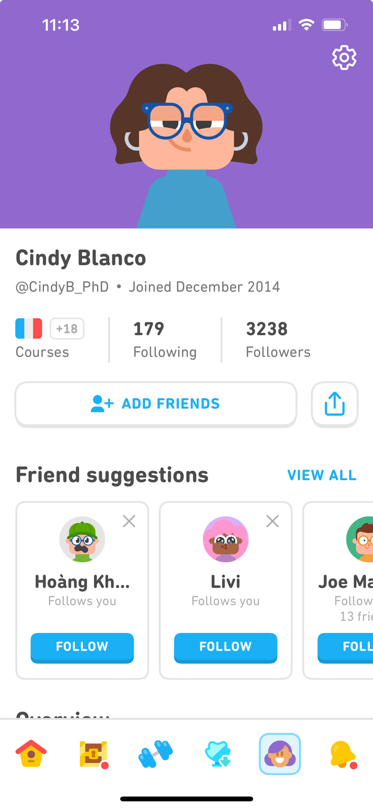

# Визуальная задача: профиль, награды, настройки ребёнка, вход и условная покупка

Для отдельного визуального агента. Логика реализована и описана в `2026-11-03-profile-account-functional-spec.md`. Здесь фиксируется только визуальная и композиционная часть запроса.

Проект: `/Users/maxim_kio/Code/reading-school`.

## Референс пользователя

Использовать принцип карточки профиля, области аватара, краткой статистики и списка наград. Не переносить социальные блоки, подписчиков, друзей, валюты, публичный ник и дату регистрации из референса. Это детский профиль в горизонтальном приложении.

## 1. Профиль ребёнка — композиция landscape

**Левая часть:** имя / «Юный читатель», действие изменения, компактная статистика, ниже вертикальный список наград.

**Правая часть:** крупный аватар ребёнка на отдельном фоне или паттерне. Он должен стать основным изображением правой колонки; подбирать размер по доступной высоте, а не ограничиваться навигационной иконкой. Настройки профиля — шестерёнка в верхнем правом углу этой области.

Прокрутка длинного списка относится к левой колонке. Аватар и выход в шапке не должны уезжать вместе с наградами. На самом маленьком landscape допускается более компактная компоновка, но смысл «информация слева, аватар справа» сохраняется.

Компоненты и привязки:

- `ProfileView` из `ProfileScreens.tsx`.
- `.profile-workspace`, `.profile-copy`, `.profile-avatar-card`, `.profile-avatar-preview`, `.profile-gear`.
- `data-background="meadow|confetti|stars"` на правой карточке — готовый контракт фона.
- `avatarIcon(state.avatar)` уже выбирает персонажа. Не создавать новую независимую модель аватара.

## 2. Фоны аватара

Есть три выбора с готовыми идентификаторами:

- `meadow` — «Лужайка».
- `confetti` — «Конфетти».
- `stars` — «Звёзды».

Сейчас это простые подложки из существующих токенов и подпись выбранного фона. Создать соответствующие паттерны или спокойные фоны в языке текущего приложения. Не закрывать лицо и не снижать контраст кнопки настроек. Паттерны являются декоративными, не должны постоянно анимироваться.

## 3. Краткая статистика

Три небольшие карточки/ячейки:

- Разных слов.
- Уроков пройдено.
- Тренировок.

Данные предоставляет `profileStats(state)`. Нулевые значения являются нормальным состоянием. Не рисовать фиктивные цифры из референса и не переименовывать слова в «освоенные»: приложение не проверяет речь.

Сохранить различимость цифры и подписи. При длинных подписях разрешить перенос вместо сокращения до непонятных обозначений.

## 4. Список наград

`profileAwards(state)` возвращает ID, название, условие, иконку, факт получения и прогресс. `.profile-awards li[data-earned=true|false]` — привязка состояния.

Четыре награды:

1. Первое слово.
2. Первая звезда.
3. Первые четыре слова.
4. Первая тренировка.

Полученные награды размещаются первыми и имеют явную отметку получения. Для будущих показать понятное состояние ожидания и прогресс. Не различать состояния только цветом. Сохранять короткое название и условие; не добавлять валюты, платные награды и XP.

Можно заменить текущие условные `book/star/trail` на согласованные медали, сохранив ID и правила получения. Никакая декоративная анимация не начисляет награду и не меняет счётчик.

## 5. Настройки ребёнка

Экран `profileSettings`, компонент `ProfileSettings`.

Та же композиция: слева настройки, справа крупный предварительный просмотр. Черновик уже работает: имя, персонаж и фон меняют preview, «Сохранить» применяет, «Отмена» отбрасывает изменения.

Сейчас персонаж и фон выбираются нативными списками. Если заменить их визуальной сеткой жетонов, сохранить семантику выбора, подписи, состояние выбранного элемента и минимум 56×56 px. Имя необязательно, максимальная длина 24 символа. Не путать эту форму с полями взрослого.

Контракты: `.child-profile-fields`, `.child-name-field`, `.child-settings-actions`, существующие ключи `avatars` и `BACKGROUNDS`. Не менять ID вариантов ради оформления.

Первичное оформление `profileSetup` пока проще полной формы настроек. Можно визуально согласовать их, сохранив разные назначения «Позже» и «Отмена».

## 6. Аккаунт взрослого и формы

Новые экраны: `account`, `login`, `register`, `passwordReset`, `passwordResetSent`.

Слева основная форма, справа спокойный информационный/иллюстративный блок «Для взрослого». Позицию можно уточнить, но все поля и кнопки должны быть достижимы при высоте 320 px: прокрутка формы предпочтительнее уменьшения целей нажатия.

Требуются состояния:

- Пустая форма.
- Поле с ошибкой и пояснением рядом с ним.
- Отправка: повторное нажатие недоступно.
- Ошибка учётных данных / повторная почта.
- Успешный вход и аккаунт взрослого.
- Принятый запрос восстановления пароля.
- Возврат без входа.

Сохранить заметное, спокойное сообщение о демонстрационном режиме и просьбу использовать вымышленные данные. Не оформлять экран так, будто это настоящая защищённая серверная авторизация. Тестовый аккаунт находится в раскрываемом блоке и не должен конкурировать с основным действием.

## 7. Доступ и условная покупка

Экраны: `access`, `checkout`, `paymentSuccess`, `paymentFailed`.

- На доступе разделить бесплатный первый урок и пример полного доступа.
- Тестовая цена 990 ₽ и разовый характер покупки — данные конфигурации `DEMO_PRODUCT`, не художественные подписи, зашитые в картинку.
- На оплате видно, что списаний нет и данные карты не нужны. Это сообщение нельзя спрятать в малочитаемую сноску.
- Сейчас для проверки сценария есть список «Успешный платёж» / «Отказ в оплате». Его можно оформить как выбор тестового способа; не добавлять поля настоящей карты или банковские логотипы, обещающие реальную интеграцию.
- Состояние обработки, отказ, повтор, отмена и успех должны быть зрительно различимы.
- В активном состоянии доступа не показывать повторную покупку. Действие восстановления предусмотрено отдельно.
- Успех оплаты не заменяет награду за чтение. Не использовать детскую звезду как подтверждение покупки.

Компонент `AdultScreens` отвечает за вызовы и состояние. Внешний платёжный виджет в эту задачу не входит.

## 8. Визуальные ограничения и проверка

- Сохранять текущую палитру и её токены; Pofo — интерфейс, Ahner — учебные слова.
- Все интерактивные области не меньше 56×56 px. Не уменьшать кнопки и поля, чтобы уместить форму.
- `src/profile-account.css` — временная структурная оболочка. Интегрировать оформление в действующую систему, не добавляя каскад `!important`.
- Не менять `core.ts`, `session.ts`, `productSession.ts`, правила статистики, сервис покупки и проверки форм ради визуала.
- Проверять пустое имя, имя из 24 широких букв, 0 наград, все полученные награды, длинную почту, ошибки формы и прокрутку.
- Размеры: 667×320, 667×375, 844×390, 932×430, рамка устройства на широком экране. Portrait остаётся «Поверни экран».
- В учебных экранах не возвращать профиль, настройки и оплату.
- `npm run build`, `npm test`, `npm run test:e2e` должны оставаться зелёными.
